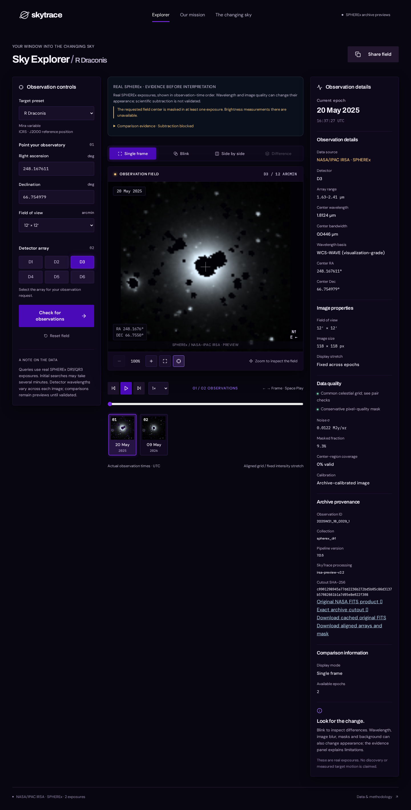

# SkyTrace — real SPHEREx sky previews

SkyTrace is a Next.js + FastAPI tool for inspecting real, dated SPHEREx infrared exposures from NASA/IPAC IRSA. Built for the 2026 NASA Space Apps “Planet X and SPHEREx” challenge.

**The default Explorer loads two genuine R Draconis field exposures without contacting IRSA.** Custom RA/Dec requests use a bounded archive worker and the same FITS processor. Original FITS cutouts, numeric arrays, masks, checksums and provenance are included for the featured demonstration. All five challenge presets have bundled D3 / 12-arcminute previews: 22 real exposures in total. This establishes image availability, not five validated scientific time-lapses.

**Scientific subtraction is disabled for real observations.** The default R Draconis pair has a masked center and its measured registration residual exceeds the conservative preview threshold; spectral-response equivalence, PSF matching and background validation are also unfinished. Blink and side-by-side are inspection previews. SkyTrace does not claim a discovery, measured proper motion, or calibrated variability detection.

## Run with Docker

```sh
docker compose up --build
```

Open http://localhost:3000. One container serves Next.js and a local FastAPI worker; the named volume retains runtime jobs and downloaded data. No NASA API key is needed. The public hosting setup is separate; this repository does not claim an existing public deployment. See [deployment instructions](docs/DEPLOYMENT.md).

## Run locally

Use Python 3.12 and Node.js 24.

```sh
python -m venv backend/.venv
. backend/.venv/bin/activate
pip install -r backend/requirements-tested.txt
cd frontend
npm ci
cd ..
npm run dev
```

Open http://localhost:3000/explore. The Python API is also available at http://127.0.0.1:8000/docs. The launcher uses `backend/.venv` when present. `API_INTERNAL_URL` configures the Next.js proxy when running services separately and must be supplied at **build time** for standalone production builds.

## Demonstration

The initial field is R Draconis, ICRS RA 248.167611°, Dec 66.754979°, 12 arcminutes, D3.

- Observation A: `2025W21_1B_0329_1`, May 20, 2025 at 16:37:27.588 UTC.
- Observation B: `2026W19_2A_0976_1`, May 9, 2026 at 23:44:07.234 UTC.
- Field-center wavelengths: approximately 1.812419 and 1.812466 µm.
- The evidence panel reports overlap, per-pixel wavelength screening, measured field-source registration, and unverified science checks.
- The frame inspector links to each original NASA FITS product and exact cutout, with SHA-256, cached-original FITS and numeric-array downloads. The masked center is explicitly reported; do not infer target brightness from it.

A coordinate preset identifies a field, not proof the named source is visible or detected. High-proper-motion sources can move substantially from reference coordinates. The five challenge presets remain available, but coverage, image quality and repeated passbands differ.

Bundled preview counts: Barnard’s Star field 6, Epsilon Indi B field 2, WISE 0855 field 6, RW Aurigae field 6, R Draconis field 2. Other settings start a bounded live query.

## What is implemented

- Real DR1/QR3 wide-survey discovery, product deduplication, footprint-assisted candidate ranking and bounded downloads.
- Calibrated FITS IMAGE/VARIANCE/FLAGS/ZODI reading, conservative named-bit masking, one zodiacal-model subtraction, spectral-WCS lookup and common-grid reprojection.
- Shared numeric science/display pipeline for featured and custom fields; one reproducible display stretch per set.
- Asynchronous, deduplicated SQLite jobs; one processing worker; queue, time, byte, FOV, cache and admission limits.
- Playback, blink, side-by-side, loading/error/no-coverage/incomplete states, coordinate URLs, metadata and downloadable provenance.
- Server-side blocking of real subtraction. The preserved opt-in simulator still demonstrates float-array B − A.



## Validation

```sh
. backend/.venv/bin/activate
python -m pytest -q backend/tests
python backend/tools/verify_featured.py
cd frontend
npm test
npm run typecheck
npm run build
npx playwright install --with-deps chromium
npm run test:e2e
npm run test:e2e:demo
```

[Validation evidence](docs/VALIDATION.md) distinguishes executed checks from limitations. GitHub Actions runs numerical/API tests, offline FITS reproduction, frontend checks and both browser modes. Ordinary tests do not depend on live IRSA availability.

## Refresh featured data

```sh
python backend/tools/prepare_featured.py --target r-dra --output backend/data/new-snapshot
```

Use `--target all` to attempt all five presets. A live query may fail or produce only previews. Review the manifest and raw FITS before promoting a new snapshot; the checked-in featured data never silently refreshes.

## Synthetic development mode

```sh
OBSERVATION_SOURCE=synthetic NEXT_PUBLIC_ENABLE_SYNTHETIC_DEMO=true npm run dev
```

Both flags are required to view generated observations. Synthetic dates, motion, brightness and units are illustrative and never relabeled as SPHEREx measurements. Landing-page artwork and animations remain labeled educational illustrations.

## Documentation

- [Submission description and demonstration script](docs/SUBMISSION.md)
- [API and job contract](docs/API.md)
- [Processing methods and scientific limits](docs/METHODOLOGY.md)
- [Real-data integration status](docs/REAL_DATA_INTEGRATION.md)
- [Deployment](docs/DEPLOYMENT.md)
- [Validation](docs/VALIDATION.md)

## Data acknowledgement

This publication makes use of data products from the Spectro-Photometer for the History of the Universe, Epoch of Reionization and Ices Explorer (SPHEREx), which is a joint project of the Jet Propulsion Laboratory and the California Institute of Technology, and is funded by the National Aeronautics and Space Administration.

Data and methods: [IRSA access](https://caltech-ipac.github.io/spherex-archive-documentation/spherex-data-access/), [data products](https://caltech-ipac.github.io/spherex-archive-documentation/spherex-data-products/), [spectral-image tutorial](https://caltech-ipac.github.io/irsa-tutorials/spherex-intro/), [cutout tutorial](https://caltech-ipac.github.io/irsa-tutorials/spherex-cutouts/). Editorial image credits remain in the About page and `frontend/public/images/credits.json`.
